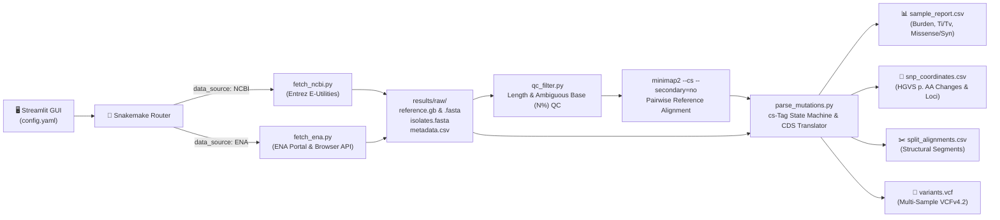

# 🧬 Iostrack: Automated Viral Genomics & Mutational Surveillance Engine


**Iostrack** is an end-to-end bioinformatics workflow and interactive surveillance GUI designed to fetch, quality-filter, align, and functionally annotate viral isolate genomes from **NCBI Entrez** and the **European Nucleotide Archive (ENA)**.

Built with **Snakemake** for reproducible workflow orchestration and **Streamlit + Plotly** for real-time visual analytics, Iostrack transforms raw unaligned FASTA sequences into actionable epidemiological metrics—including **GenBank CDS amino acid consequences**, **$Ti/Tv$ mutational signatures**, **structural split-alignment coordinates**, **pairwise SNP distance matrices**, and **standards-compliant multi-sample VCFv4.2 exports**.

Iostrack is open source and free to use. Includes a custom Dark and Light mode depending on visual preference. Also supports WSL!

---
## 🖼️ GUI Environment

Interactive plots which visualize SNP counts and types across multiple sequences compared to the reference sequence.


## 🏗️ Pipeline Architecture


---
## 📥 Installation

From your preferred Linux/WSL command prompt: 

```bash
git clone https://github.com/StephOverratedMage/iostrack.git
cd iostrack

conda env create -f environment.yml
conda activate iostrack

#Run the automated tests to verify installation
python -m pytest -v

#Open the interactive GUI dashboard
streamlit run app.py
```
#### Once the GUI opens, configure your settings in the sidebar to the left and then click "**🚀 Run Pipeline**" to start pipeline execution. NOTE: When querying NCBI, a valid e-mail address is required for their API.
---
## 🔜 Future prospects

**Iostrack is a prototype and work in progress. Features coming soon include: More customizability within plots, as well as more diverse and useful visualizations. More ways to analyze and sort results. 
Any feedback is appreciated!** 
