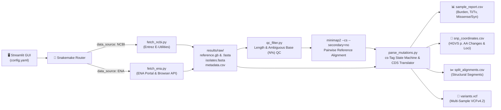

# 🧬 Iostrack: Automated Viral Genomics & Mutational Surveillance Engine


**Iostrack** is an end-to-end bioinformatics workflow and interactive surveillance GUI designed to fetch, quality-filter, align, and functionally annotate viral isolate genomes from **NCBI Entrez** and the **European Nucleotide Archive (ENA)**. "Ios" comes from the Greek word meaning "virus".

Built with **Snakemake** for reproducible workflow orchestration and **Streamlit + Plotly** for real-time visual analytics, Iostrack transforms raw unaligned FASTA sequences into actionable epidemiological metrics—including **GenBank CDS amino acid consequences**, **$Ti/Tv$ mutational signatures**, **structural split-alignment coordinates**, **pairwise SNP distance matrices**, and **standards-compliant multi-sample VCFv4.2 exports**.

Iostrack is open source and free to use. Includes a custom Dark and Light mode depending on visual preference. Also supports WSL!

---
## 📋 Contents
- [Features](#features)
- [GUI Environment](#gui-environment)
- [Pipeline Architecture](#pipeline-architecture)
- [Requirements](#requirements)
- [Installation](#installation)
- [Example Run](#example-run)
- [Results](#results)
- [Roadmap](#roadmap)
- [License](#license)
---
## 🛠️ Features

* Allows for querying the NCBI or ENA databases to fetch DNA sequences based on search terms (Organism, title terms) or accession numbers.
* Aligns all results to a reference genome specified by the user.
* Filters results by minimum length (bp), maximum N content percentage, maximum divergence from the reference and setting a maximum number of results to be displayed and analyzed.
* Displays analytical matrices detailing total mutations per accession or per primary segment based on the Minimap2 alignments. Mutation types (transition/transversion) as well as their ratio are also included.
* Visualizes total SNPs and GC content per accession.
* Produces a heatmap of mutations across the reference genome, with the option to overlay coding region limits over the heatmap.
* Visualizes the pairwise SNP distance between all analyzed genomes.
* Generates VCF/CSV and alignment reports.

## 🖼️ GUI Environment

Configure search and filtering through the sidebar:


Interactive plots which visualize SNP counts and types across multiple sequences compared to the reference sequence.


## 🏗️ Pipeline Architecture


---
## ✅ Requirements

* **Linux or WSL2** due to Minimap2 and Snakemake being intended for Linux. Native Windows is untested.
* Conda, Miniconda, Mamba or Miniforge. IDEs such as VSCode with WSL access also work.
* Python 3.11 (other versions not tested yet).
* Internet access for NCBI or ENA queries. If results are already present, it is not required.

---
## 📥 Installation

From your preferred Linux/WSL command prompt: 

```bash
git clone https://github.com/StephOverratedMage/iostrack.git
cd iostrack

conda env create -f environment.yml
conda activate iostrack

#Run the automated tests to verify installation
python -m pytest -v

#Open the interactive GUI dashboard
streamlit run app.py
```
## 💡 Example Run

1. Select `NCBI` as the data source.
2. Enter a reference accession, such as `NC_001781.1`.
3. Select **By Organism & Keyword**.
4. Enter the organism and sequence title filter. Leave the title filter empty to automatically disable it.
5. Provide an NCBI email address.
6. Set quality-control thresholds.
7. Click **🚀 Run Pipeline**.

### NOTE: When querying NCBI, a valid e-mail address is required for their API.
---
## 📊 Results

Iostrack organizes its outputs hierarchically inside the `results/` directory. Below is the reference guide for every file generated during a pipeline execution:

| Directory / File | Category | Description & Downstream Purpose |
| :--- | :--- | :--- |
| **`results/raw/reference.fasta`** | Reference | Raw nucleotide sequence of the baseline reference genome used by `minimap2`. |
| **`results/raw/reference.gb`** | Reference | GenBank flat file (`.gb`) parsed by Biopython to extract viral gene boundaries (`CDS`) and reading frames. |
| **`results/raw/isolates.fasta`** | Raw Input | Filtered pool of viral isolate genomes downloaded from NCBI Entrez or the ENA Portal API. |
| **`results/raw/metadata.csv`** | Metadata | Cohort metadata (`Accession`, `Title`, `Length_bp`, `UpdateDate`) mapped to GUI dataframes. |
| **`results/qc/clean_isolates.fasta`** | Quality Control | Subset of isolate genomes that successfully passed length and ambiguous base (`N%`) QC filters. |
| **`results/qc/qc_report.csv`** | Quality Control | Per-sample QC metrics table tracking `Length_bp`, `GC_Percent`, `N_Percent`, and pass/fail `Status`. |
| **`results/align/alignments.paf`** | Alignment | Raw Pairwise Alignment Format (`.paf`) containing high-resolution mapping coordinates and `cs:Z:` tags. |
| **`results/summary/split_alignments.csv`** | Structural | Detailed coordinate breakdown of non-secondary mapped segments (including split/supplementary alignments). |
| **`results/summary/gene_features.csv`** | Annotation | Structured table of reference viral genes (`Gene`, `Product`, `Start`, `End`, `Strand`) for CDS track overlays. |
| **`results/summary/sample_report.csv`** | Summary Report | Aggregated cohort report combining mutational burdens, $Ti/Tv$ ratios, and $dN/dS$ missense/synonymous metrics. |
| **`results/summary/snp_coordinates.csv`** | Variant Loci | Granular locus-by-locus table of every SNP, tracking base changes, mutational classes, and HGVS protein changes. |
| **`results/summary/variants.vcf`** | Interoperable | Standards-compliant **Multi-Sample VCF v4.2** file with `NS`, `AF`, `GENE`, `CONSEQ`, `AA`, and binary sample genotypes (`GT`). |

NOTE: Snakemake will skip previous steps of a pipeline execution if the configuration is unchanged. Thus, to re-submit a query with the same configuration, the results folder must be cleaned. One way to do so is:
```bash
rm -rf results/summary/* results/align/* results/raw/* results/qc/*
```
#### **Warning:** This will permanently delete generated pipeline outputs. Do not run if you need to preserve previous results. Instead, save them to another folder before cleaning up.
---
## 🔜 Roadmap

**Note: Iostrack is a prototype and work in progress. Results should be independently reviewed before being used in publications, clinical workflows, or public-health decisions.
Features coming soon include: More customizability within plots, as well as more diverse and useful visualizations. More ways to query, filter, analyze and sort results. 
Any feedback is appreciated!** 

## 📝 License
This project is licensed under the MIT License. See [LICENSE](LICENSE).
